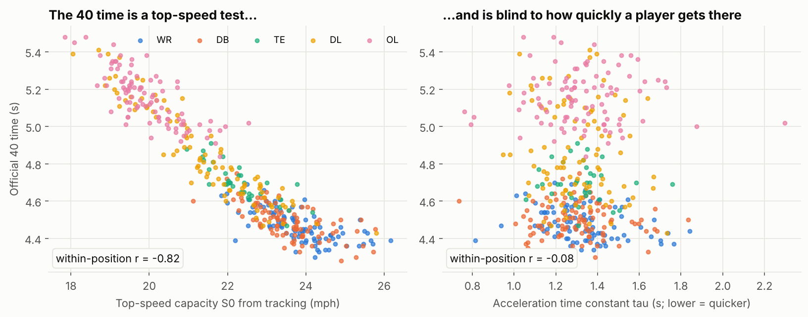
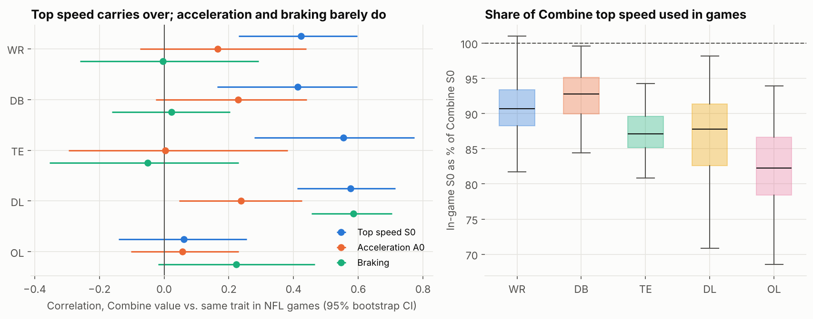
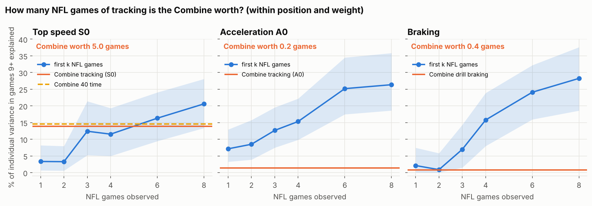
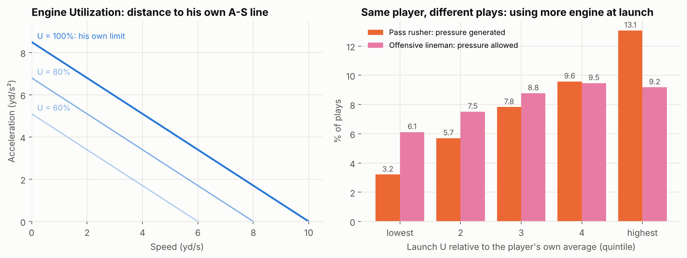
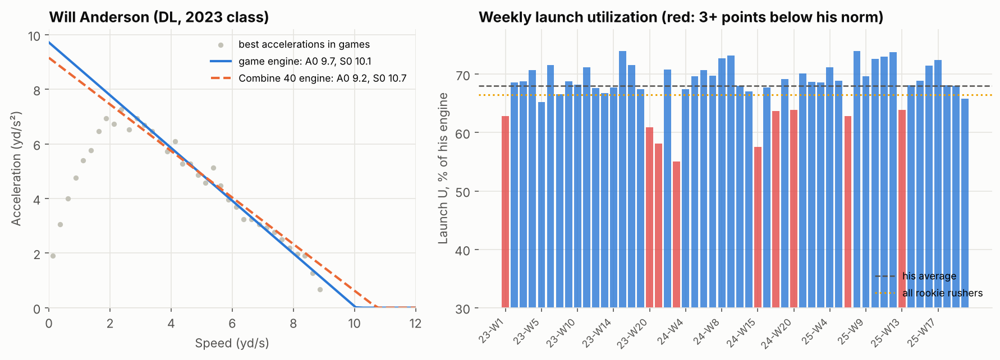

# How Many NFL Games Is the Combine Worth?

*Measuring the same sprint "engine" in Indianapolis and on Sundays, and how much of it rookies use on each snap.*

## Summary

A 40-yard dash and an NFL snap are both governed by the same two numbers: how hard a player can accelerate from a standstill (**A0**) and the top speed he is heading towards (**S0**). We measure both from 10 Hz Combine tracking *and* from the same rookies' NFL game tracking, in the same units. Our main results:

1. **The 40 time is a top-speed test.** Within position, it tracks S0 closely (r = −0.82) and says almost nothing about how quickly a player gets going (r = −0.08 with the acceleration time constant τ).
2. **The Combine is worth about 5 NFL games for top speed, and less than one game for acceleration or braking.** After Week 1, a rookie's own game tracking tells you more about his acceleration than everything measured in Indianapolis.
3. **Engine size does not win reps; using it does.** After role, size and draft slot are accounted for, no player-level link between engine size and outcomes survives a false-discovery correction. But on plays where a pass rusher launches with 10 points more of his *own* engine than usual, pressure rises by 2.2 percentage points (base rate 7.9%).

We package this as a weekly **Rookie Engine Card**.

## 1. Why a stopwatch is not enough

Combine times predict draft slot better than NFL play; links to performance are modest and position-dependent (McGee & Burkett, 2003; Kuzmits & Adams, 2008; Vincent et al., 2019). A single time mixes acceleration, top speed and, in agility drills, braking (Nimphius et al., 2016; Harper et al., 2019), and the usual outcomes (games, starts) partly reflect draft capital (Keefer, 2017; Massey & Thaler, 2013).

Tracking at both ends allows a sharper question: **is the engine measured at the Combine the engine we see in games, and does the player use it?**

## 2. One engine, measured twice

**At the Combine.** For 412 prospects with a clean tracked 40 (median fit error 0.20 yd/s), we fit the mono-exponential sprint model v(t) = S0·(1 − e^(−t/τ)) (Samozino et al., 2016; applied to Combine splits by Clark et al., 2019). Its acceleration falls on a straight line from **A0 = S0/τ** at zero speed to zero at **S0**.

**In games.** For 497 rookies (10,457 player-games), we compute signed acceleration from the change in speed (the provided `a` is a magnitude and cannot tell braking from speeding up). In every 0.25 yd/s speed bin we keep the second-best acceleration across games, so one glitchy frame cannot set a profile. We then fit the same straight line, which gives the *in-situ* acceleration-speed profile of Morin et al. (2021) (median R² = 0.97). A braking capacity is built the same way from the hardest decelerations between 3 and 7 yd/s.

Both profiles live on the same A–S plane. The game profile is very stable: split-half reliability across games is 0.96 for S0, 0.93 for A0 and 0.97 for braking (Spearman–Brown; n = 360 rookies, 287 for braking).

## 3. Finding 1: the 40 time is a top-speed test

*Figure 1. Left: official 40 time vs. tracked S0. Right: vs. the acceleration time constant τ. Correlations are within position.*

Even the 10-yard split, often read as an "acceleration" number, follows S0 (r = −0.60) and is unrelated to τ (r = +0.02). Tracking separates acceleration from speed, but the acceleration parameters are noisier: test-retest r across two 40 attempts is 0.96 for S0, 0.67 for A0 and 0.52 for τ.

## 4. Finding 2: what carries over, and how much speed rookies use

*Figure 2. Left: correlation between each Combine trait and the same trait in NFL games (rookies with 8+ games; 95% bootstrap CIs). Right: in-game S0 as a share of Combine S0.*

Top speed carries over for WR, DB, TE and DL (r = 0.41–0.58). Acceleration barely does (r ≤ 0.24), and drill braking only for DL (r = 0.58, falling to 0.32 once body weight is removed). Offensive linemen show almost no carry-over: their game movement is short, assignment-bound steps.

Rookies rarely reach their Combine top speed in games. The median in-game S0 is 93% of Combine S0 for DBs, 91% for WRs, 88% for DL, 87% for TEs and 82% for OL.

## 5. Finding 3: the Combine is worth about five games for top speed

For the 229 rookies with at least 16 games, the target is the engine they showed in **games 9 onward**. We remove position-group means and body weight from target and predictors, so nobody is rewarded for being a receiver instead of a guard. We then ask how much of the remaining individual variation is explained by (a) the Combine and (b) the profile measured from only the first *k* NFL games. The point where the curves cross is what the Combine is "worth" in games of NFL tracking (500 player bootstraps).

*Figure 3. Share of individual variance in games 9+ explained by the Combine (horizontal lines) and by the first k NFL games (curve, 90% bootstrap band).*

| Trait | Combine measure | Variance explained by Combine | …by game 1 | …by games 1–8 | Combine is worth (90% interval) |
|---|---|---|---|---|---|
| Top speed S0 | tracked S0 | 13.9% | 3.3% | 20.6% | **5.0 games** (2.2 to >8) |
| Top speed S0 | official 40 time | 14.6% | 3.3% | 20.6% | 5.3 games (2.2 to >8) |
| Acceleration A0 | tracked A0 | 1.3% | 7.1% | 26.3% | **0.2 games** (0.0–0.9) |
| Braking | drill braking | 0.8% | 2.1% | 28.2% | **0.4 games** (0.0–2.7) |

*Table 1. How many NFL games of tracking the Combine is worth, within position and weight.*

**Football translation.** For top speed, keep leaning on the 40 for roughly a rookie's first five games; the official time is as good as the tracked S0. For acceleration and braking, trust the game tape from the first game. Combine tracking separates A0 from S0, but the A0 it measures in a straight-line sprint is not the A0 a player shows in games.

## 6. Finding 4: engine size does not win reps, engine use does

We first tested whether engine size predicts per-snap outcomes:
- pass-rush get-off and pressure rate;
- route-adjusted separation at the throw (separation minus the average for that route type);
- offensive-line pressure-allowed rate.

Rates are shrunk with empirical Bayes (Efron & Morris, 1975); each test removes body weight, draft slot and role (edge, slot or tackle share), heeding Westfall & Yarkoni (2016). Of 24 tests, none survives Benjamini–Hochberg correction (smallest q = 0.13). Bigger engines alone do not produce better reps.

So we define a play-level metric. On a player's own A–S line, a/A0 + v/S0 = 1 at any speed. **Engine Utilization U = a/A0 + v/S0**, computed frame by frame with the player's own in-game profile, says what share of his engine he is using: 100% means his personal limit. For each play we take the peak U in the **first second after the snap** (launch U). That comes before the pressures we count, so pressure cannot drive it.

*Figure 4. Left: lines of equal utilization on the A–S plane. Right: outcome rates by quintile of launch U, measured relative to each player's own average.*

| Role and outcome (within-player models, player-clustered SEs) | Effect of +10 U-points | 95% CI | Plays / players |
|---|---|---|---|
| Pass rusher: pressure probability (base 7.9%) | **+2.2 pp** | +1.8 to +2.5 | 43,881 / 195 |
| Pass rusher: get-off time | −0.10 s | −0.10 to −0.09 | 43,881 / 195 |
| Receiver: separation at throw (route, time to throw controlled) | +0.07 yd | +0.03 to +0.10 | 46,154 / 154 |
| Offensive lineman: pressure allowed (base 8.2%) | +0.7 pp | +0.5 to +0.9 | 60,286 / 179 |

*Table 2. Same player, different plays.*

For the same rusher, pressure comes on 3.2% of plays in his lowest launch-U quintile and 13.1% in his highest; adding a blitz flag leaves +1.6 pp. The relationship flips for offensive linemen: a lineman who has to launch hard is usually a lineman under stress (6.1% pressure allowed in his calmest quintile vs. 9.2–9.5% in the top two). Each rusher's average launch U is a stable habit (split-half reliability 0.93), and the Combine does not see it: partial r with the 40, S0 and A0 is between −0.11 and +0.13, and every interval includes zero.

The Combine measures engine size (well, for top speed); how much engine a player brings to the snap must be learned from games.

## 7. The Rookie Engine Card: week-to-week use

*Figure 5. Example card for Will Anderson (DL, 2023 class), the rookie with the most tracked pass rushes. Left: Combine 40 engine (dashed) vs. game engine (solid). Right: weekly launch U; red marks weeks at least 3 points below his norm.*

After every game, the card refreshes three numbers per rookie:

- **Engine (A0, S0, braking).** Start from the Combine prior for top speed. From Week 1, switch to game tracking for acceleration and braking (Table 1).
- **Share of engine used.** In-game S0 as a share of Combine S0. A WR or DB stuck well below his position's 91–93% is either not being asked to open up or is not able to.
- **Launch U by week**, against his own norm. A drop is a prompt for the staff (fatigue, injury, assignment or technique), not a verdict.

Scouts use the Combine part (trust the 40 for speed, discount drill-based acceleration); coaching and performance staff use the weekly part.

## 8. Limitations

- **Observational.** Play design (stunts, drops, quick game) can move both launch U and pressure; fixed effects remove player differences, not play-call differences.
- **Only rookies are tracked**, so opponents and the quarterback are represented only through NGS outcomes.
- **In-game A0 exceeds Combine A0 for skill positions** (moving starts vs. a three-point start), so we compare players within each setting and never subtract the two.
- **Small position samples** (25–90 players) give wide intervals, reported throughout.

## References

- Benjamini Y, Hochberg Y (1995). Controlling the false discovery rate. *JRSS B* 57(1):289–300.
- Clark KP et al. (2019). The NFL Combine 40-yard dash: how important is maximum velocity? *J Strength Cond Res*.
- Efron B, Morris C (1975). Data analysis using Stein's estimator and its generalizations. *JASA* 70(350):311–319.
- Harper DJ, Carling C, Kiely J (2019). High-intensity acceleration and deceleration demands in elite team sports competitive match play. *Sports Med* 49:1923–1947.
- Keefer QAW (2017). The sunk-cost fallacy in the National Football League. *J Sports Econ* 18(3):282–297.
- Kuzmits FE, Adams AJ (2008). The NFL Combine: does it predict performance in the National Football League? *J Strength Cond Res* 22(6):1721–1727.
- Massey C, Thaler RH (2013). The loser's curse. *Manag Sci* 59(7):1479–1495.
- McGee KJ, Burkett LN (2003). The National Football League Combine: a reliable predictor of draft status? *J Strength Cond Res* 17(1):6–11.
- Morin J-B, Le Mat Y, Osgnach C, et al. (2021). Individual acceleration-speed profile in-situ: a proof of concept in professional football players. *J Biomech* 123:110524.
- Nimphius S, Callaghan SJ, Spiteri T, Lockie RG (2016). Change of direction deficit. *J Strength Cond Res* 30(11):3024–3032.
- Samozino P, Rabita G, Dorel S, et al. (2016). A simple method for measuring power, force, velocity properties, and mechanical effectiveness in sprint running. *Scand J Med Sci Sports* 26(6):648–658.
- Vincent LM, Blissmer BJ, Hatfield DL (2019). National Scouting Combine scores as performance predictors in the National Football League. *J Strength Cond Res* 33(1):104–111.
- Westfall J, Yarkoni T (2016). Statistically controlling for confounding constructs is harder than you think. *PLoS ONE* 11(3):e0152719.

## Appendix: code

Every number, table and figure comes from the attached public notebook, which runs end to end on the competition data.
