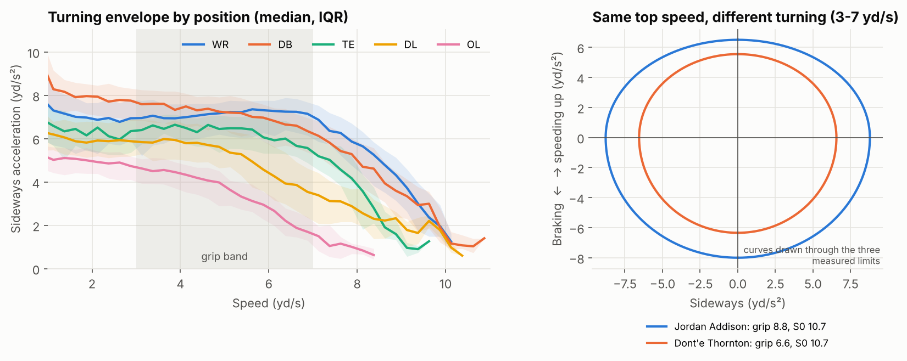
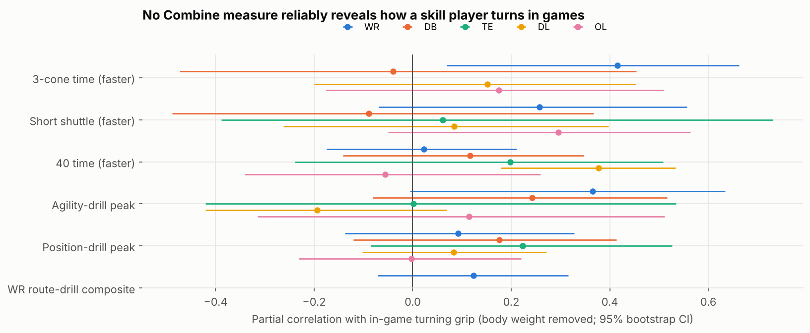
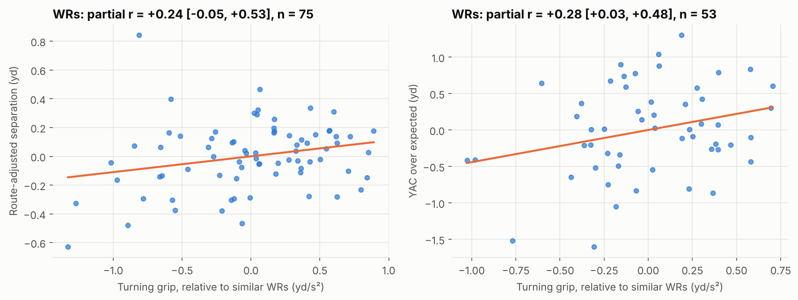
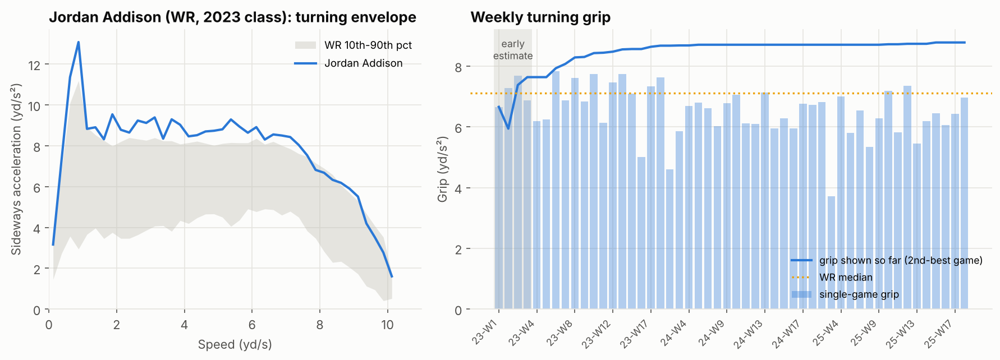

# Bend, Don't Brake: The Turning Engine the Combine Cannot See

*A g-g diagram for football players: how hard a rookie can turn at speed, whether any Combine drill reveals it, and what it means for receivers.*

## Summary

The Combine measures straight-line speed well. Turning it barely measures at all. A player running a curved path needs **sideways (centripetal) acceleration**, a_c = speed × turn rate. Like a car's tyres, every athlete has a limit on how much of it he can produce at each speed. We measure that **turning envelope** from 10 Hz game tracking of 497 rookies and from every Combine drill.

1. **Turning grip is a stable, position-specific trait.** Split-half reliability across games is 0.97.
2. **No Combine measure reliably reveals it for skill players.** The 40, the shuttle, position drills and a WR route-drill composite all show within-position correlations of 0.26 or less. The best hint is the 3-cone for WRs (r = 0.42), but only 25 of them ran it.
3. **Grip is the trait most associated with receiving outcomes**, ahead of top speed and the 40: WR separation (partial r = 0.24), WR yards after catch over expected (0.28), TE separation (0.52). The intervals are wide and none survives a false-discovery correction, so we present this as a lead to confirm, not a law.

We package it as a weekly **Turning Card**.

## 1. Motivation

Change-of-direction research separates *pre-planned* change of direction from reactive *agility* (Sheppard & Young, 2006). It also shows that sharper turns cost speed: the angle-velocity trade-off (Dos'Santos et al., 2018). Stopwatch drills fold braking, turning and re-acceleration into one time (Nimphius et al., 2016), and links between Combine results and NFL performance are modest (Kuzmits & Adams, 2008; Vincent et al., 2019). Route breaks, pursuit angles and moves after the catch are mostly *curved* running at speed. That is a separate physical capacity, and nothing at the Combine isolates it.

We borrow a tool from motorsport, the g-g diagram (forward, braking and sideways acceleration limits), and estimate each player's sideways limit the way Morin et al. (2021) estimate an in-situ acceleration-speed profile: from the best efforts a player produces in games.

## 2. Method

- **Turn rate.** Central difference of the motion direction (wrapped at 360°), at 10 Hz.
- **Sideways acceleration.** Smoothed speed × turn rate. Values above 15 yd/s² come from heading jumps and are dropped.
- **Envelope.** For each player, game and 0.25 yd/s speed bin we keep the hardest sideways acceleration. Across games we take the *second-best* value per bin, so a single glitch cannot set a profile.
- **Turning grip.** The envelope averaged over 3–7 yd/s, the speeds of route breaks and pursuit angles.
- **No ball in hand.** Plays where the player was targeted or carried the ball (9,868 player-plays) are removed before building the envelope. Without this, evasive moves after the catch would leak into a grip we later relate to yards after catch.

Combine envelopes are built the same way from every drill attempt (40, 3-cone, shuttle, position drills).

*Figure 1. Left: turning envelope by position (median, IQR); grip is measured in the shaded band. Right: two rookie WRs (2023 and 2025 classes) with the same in-game top speed (10.7 yd/s) but very different turning grip. The curves are drawn through each player's three measured limits.*

Median grip is 7.2 yd/s² for DBs, 7.1 for WRs, 6.3 for TEs, 5.2 for DL and 3.9 for OL. Skill players keep their turning ability up to about 7 yd/s, while linemen lose it quickly as speed rises. On the right, Jordan Addison and Dont'e Thornton have identical top speed. Addison turns with 8.8 yd/s² of sideways acceleration and Thornton with 6.6: a stopwatch cannot tell them apart.

## 3. Finding 1: a stable trait that takes a few games to learn

Across random halves of each player's games (players with 8+ games), grip correlates at 0.94, a reliability of 0.97 (n = 288). Among stability, discrimination and independence, the properties Franks et al. (2016) ask of a sports metric, grip clearly passes the first two.

It is not learned instantly. For rookies with 16+ games, the grip from only the first *k* games predicts the grip in games 9 onward (within position) at:

| Games observed | 1 | 2 | 3 | 4 | 6 | 8 |
|---|---|---|---|---|---|---|
| r with games 9+ | 0.18 | 0.15 | 0.30 | 0.50 | 0.56 | 0.63 |

*Table 1. Stabilisation of turning grip (n = 170–227).*

A rookie's turning grip is a reasonable early estimate after about **4 games** and firm by mid-season. A single game is mostly noise: few plays push a player to his turning limit.

## 4. Finding 2: the Combine's blind spot

For rookies with 8+ games we correlated in-game grip, within position and with body weight removed, against six Combine measures:
- the official 3-cone, shuttle and 40 times;
- the hardest sideways acceleration in the agility drills;
- the hardest sideways acceleration in the position drills;
- for WRs, a route-drill composite (mean z-score across the curl, comeback, dagger, post-corner and other route drills he ran).

*Figure 2. Partial correlations with in-game turning grip (95% bootstrap CIs).*

Of 25 tests, only one survives Benjamini–Hochberg correction: the 40 for DL (r = 0.38, q = 0.03), which mainly separates edge rushers from interior linemen. For skill players nothing does.
- **WRs:** the route drills, the closest thing the Combine has to real routes, say almost nothing (composite r = 0.12, n = 77). The same holds route by route: a WR's peak sideways acceleration in the Combine curl, speed-out or post-corner drill is no better a guide to his game routes of that type (r = 0.01–0.29) than any other drill.
- **The only hints** come from the 3-cone (r = 0.42, n = 25) and the agility-drill peaks (r = 0.37, n = 29), and only about a quarter of WRs ran those drills.

**Football translation.** Turning is a game skill the Combine does not test. If a team wants any pre-draft signal, it should push receivers to run the 3-cone, and a curved-running drill tracked at 10 Hz would measure the trait directly.

## 5. Finding 3: grip and receiving production

We related grip to two per-snap outcomes for players with enough volume:
- route-adjusted separation at the throw (separation minus the average for that route type);
- yards after catch over the NGS expectation (YACOE).

Each correlation removes body weight, draft slot (log pick) and slot share. Grip is compared with in-game top speed and acceleration (A–S profile), the 40 and the 3-cone.

| Outcome | Turning grip | Top speed S0 | Acceleration A0 | 40 (faster) |
|---|---|---|---|---|
| WR separation (n = 75) | **+0.24** [−0.05, 0.53] | +0.12 | +0.12 | +0.03 |
| WR YAC over expected (n = 53) | **+0.28** [0.03, 0.48] | +0.17 | −0.23 | −0.25 |
| TE separation (n = 23) | **+0.52** [0.21, 0.72] | −0.20 | +0.19 | −0.38 |

*Table 2. Partial correlations (95% bootstrap CIs shown for grip).*

*Figure 3. WRs: turning grip vs. route-adjusted separation and YAC over expected, both after removing weight, draft slot and slot share.*

In every row, grip is the trait most positively associated with the outcome. Straight-line speed adds little once a receiver is in the league, and the 40 even leans the wrong way for YAC. The honest caveat: with 23–75 players per row, none of the 18 tests survives a false-discovery correction (smallest q = 0.32). The direction is consistent, and the grip estimate excludes ball-in-hand plays, so it is not simply YAC moves measured twice. A full rookie class more would settle it.

## 6. The Turning Card: week-to-week use

*Figure 4. Example card for Jordan Addison, the 2023 WR with the highest grip among rookies with 30+ games. Left: his envelope vs. the WR 10th–90th percentile. Right: single-game grip (bars) and grip shown so far (line); the shaded weeks are the early-estimate period.*

After each game, the card shows:
- the receiver's envelope against his position band;
- his single-game grip;
- his grip shown so far, with a flag while it is still an early estimate (fewer than 4 games, per Table 1).

**How teams use it:**
- **Pro scouting and roster moves.** Rank young receivers on grip rather than 40 time.
- **Coaching.** Target route work at the speeds where a player's envelope falls below his position band.
- **Performance staff.** A run of single-game grips well below a player's norm is a prompt to check fatigue or soft-tissue load. Braking and changing direction are mechanically costly: peak deceleration forces reach up to 2.7× those of early acceleration (Harper et al., 2022).

## 7. Limitations

- Only rookies are tracked, so we cannot see the defender a receiver is turning against. Separation and YACOE from NGS stand in for him.
- A turn the play never asks for is never measured, so grip is "shown capacity". This is why we use the second-best game and a speed band most players reach.
- The Combine comparisons use 15–90 players per cell; Figure 2 shows every interval.
- The friction ellipse in Figure 1 is drawn through three measured limits (forward, braking, sideways), not fitted to combined manoeuvres.

## References

- Benjamini Y, Hochberg Y (1995). Controlling the false discovery rate. *JRSS B* 57(1):289–300.
- Dos'Santos T, Thomas C, Comfort P, Jones PA (2018). The effect of angle and velocity on change of direction biomechanics: an angle-velocity trade-off. *Sports Med* 48(10):2235–2253.
- Franks AM, D'Amour A, Cervone D, Bornn L (2016). Meta-analytics: tools for understanding the statistical properties of sports metrics. *JQAS* 12(4):151–165.
- Harper DJ, McBurnie AJ, Dos'Santos T, et al. (2022). Biomechanical and neuromuscular performance requirements of horizontal deceleration. *Sports Med* 52(10):2321–2354.
- Kuzmits FE, Adams AJ (2008). The NFL Combine: does it predict performance in the National Football League? *J Strength Cond Res* 22(6):1721–1727.
- Morin J-B, Le Mat Y, Osgnach C, et al. (2021). Individual acceleration-speed profile in-situ. *J Biomech* 123:110524.
- Nimphius S, Callaghan SJ, Spiteri T, Lockie RG (2016). Change of direction deficit. *J Strength Cond Res* 30(11):3024–3032.
- Sheppard JM, Young WB (2006). Agility literature review: classifications, training and testing. *J Sports Sci* 24(9):919–932.
- Vincent LM, Blissmer BJ, Hatfield DL (2019). National Scouting Combine scores as performance predictors in the National Football League. *J Strength Cond Res* 33(1):104–111.

## Appendix: code

Every number, table and figure comes from the attached public notebook, which runs end to end on the competition data.
